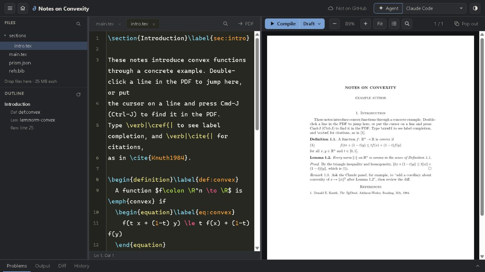
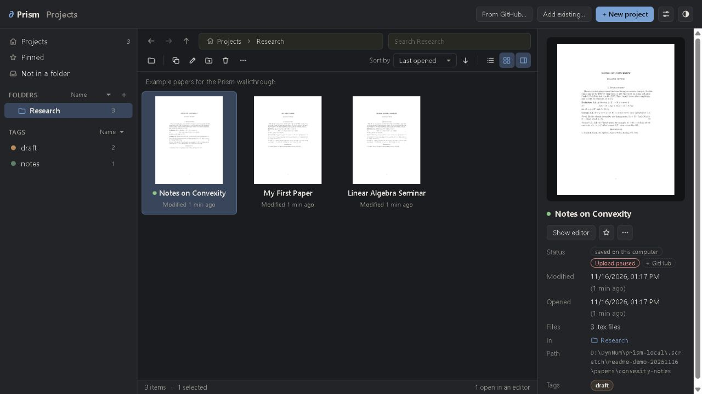
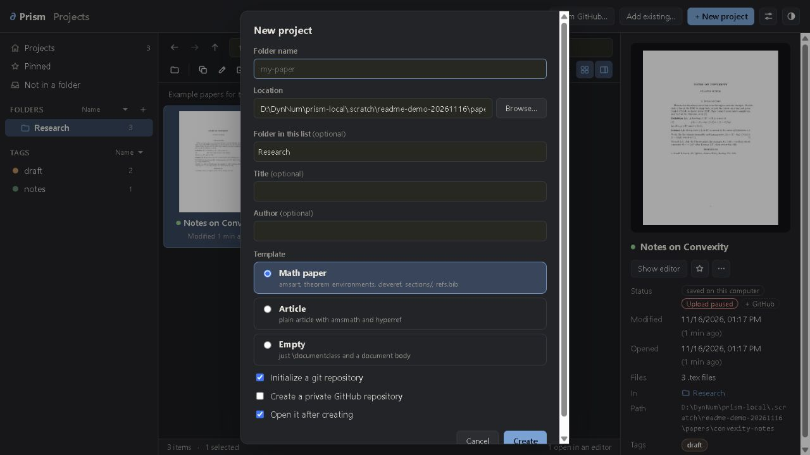
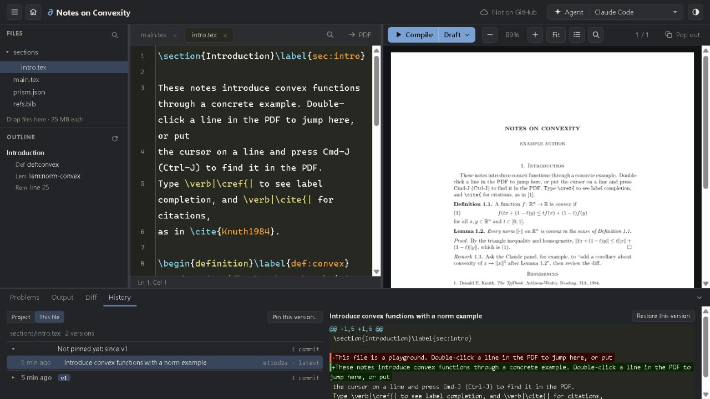
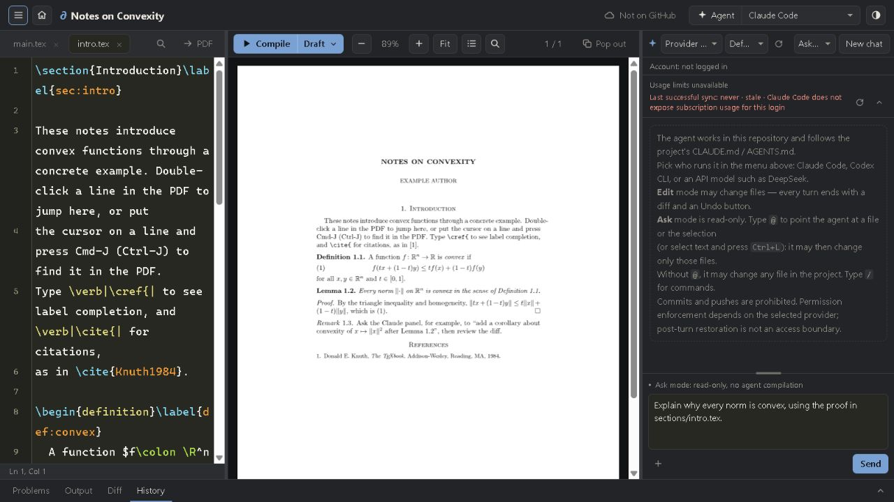

# prism-local

A local LaTeX workspace with a source editor, PDF preview, AI assistant and a Home
page for your papers. Your projects stay in ordinary folders on your computer;
GitHub sync is optional.

**Windows · macOS · Linux** · Python standard library · No pip or npm packages
needed to run Prism

[Install](#install) · [First PDF](#compile-your-first-paper) ·
[Page demos](#page-demos) · [User guide](docs/user-guide.md) ·
[中文快速安装](docs/installation.zh-CN.md)



- **Write and compile:** LaTeX highlighting, completion, math snippets, project search,
  and automatic saving. Use pdfLaTeX, XeLaTeX, LuaLaTeX or Tectonic.
- **Navigate the PDF:** double-click to jump to the source; Ctrl+J / Cmd+J to jump back.
- **Work with an AI:** choose Claude Code, Codex CLI, Deep Code or an OpenAI-compatible
  API, including local Ollama. Review changes in a diff and undo a turn.
- **Organize papers:** folders, tags, PDF thumbnails and templates on the Home page.
- **Keep history:** local git versions, named project versions and optional GitHub sync.

## Install

### 1. Run the installer

**Windows:** open **PowerShell** from the Start menu, paste this command, and press Enter:

```powershell
irm https://raw.githubusercontent.com/DengZhiyuan-math/Local-Ai-agent-for-latex/main/install.ps1 | iex
```

**macOS / Linux:** open **Terminal** and run:

```sh
curl -fsSL https://raw.githubusercontent.com/DengZhiyuan-math/Local-Ai-agent-for-latex/main/install.sh | sh
```

The installer checks Python 3.9+ and git, downloads Prism, creates a launcher and
opens the Home page in your browser. Windows can install missing tools; macOS may
ask you to install Apple's developer tools. On Linux, if tools are missing, run the
package-manager command printed by the installer, then run the installer again.

These commands download and execute the repository's installer. You can inspect
[the Windows script](install.ps1) or [the macOS/Linux script](install.sh) first, or
follow the [manual installation steps](docs/installation.md#manual-installation).

### 2. Set up LaTeX

On the Home page, look for **Getting started** (also available under **Settings →
Programs**). If a TeX distribution is already detected, keep using it. Otherwise:

| Choice | When to use it |
| --- | --- |
| **Quick start** | Downloads Tectonic; required packages download on the first compile, so keep the internet connected. |
| **Full LaTeX** | For a conventional TeX installation. The page installs MiKTeX on Windows or gives platform-specific steps. The download can be several GB. |

**You can start writing without a GitHub account or an AI subscription.** GitHub
and AI setup can wait until after your first PDF. Local history uses git.

### 3. Open Prism next time

| System | Open |
| --- | --- |
| Windows | **Prism** in the Start menu or the desktop shortcut |
| macOS | **prism-local** in Applications or Spotlight |
| Linux | **Prism** in the application menu |

Keep Python and the installed Prism folder in place: the shortcut starts them.
See [installation help](docs/installation.md) for custom folders, terminal startup
and troubleshooting.

## Compile your first paper

1. On Home, click **+ New project**. Enter a folder name such as `my-first-paper`
   and choose where to save it. Keep papers outside the Prism installation folder.
2. Choose **Article** for a simple document, or **Math paper** for theorem
   environments and a bibliography. Leave **Create a private GitHub repository**
   unchecked for a local project, then click **Create**.
3. In the editor, open `main.tex`, change the title or body, and click **Compile**
   (Ctrl+Enter on Windows/Linux, Cmd+Enter on macOS).
4. The PDF appears on the right. Double-click a line in the PDF to find its source;
   press Ctrl+J / Cmd+J in the editor to find the corresponding PDF location.

Already have a paper? Use **Add existing…** on Home and choose its folder.
For a prepared example, copy [`examples/minimal`](examples/minimal) to your papers
folder and add that copy. For a multi-file project, `prism.json` can select the
[main file and TeX engine](docs/user-guide.md#configuration-prismjson-optional).

## Page demos

Screenshots from the running app with example papers. Follow the
[illustrated walkthrough](docs/demos/README.md) to try each view.

### Project Home

Browse papers by folder and tag, see PDF thumbnails, and preview a selected project.



### Create a project

Pick a template and a folder. Local git history and private GitHub repositories
are separate choices.



### Project history

Inspect file changes and pin or restore a project version from **History**.



### AI assistant

Choose a provider and use **Ask** for a question or **Edit** for changes you can
review. This screenshot shows an unsent question; provider login is still required.



## Optional: AI and GitHub

- **AI:** use **Getting started → AI assistant** to set up Claude Code, or select
  another provider in the editor's Agent menu. CLI providers need their own
  installation and login; API providers need their own configuration and usually
  an API key. Provider charges or subscriptions are separate from Prism.
  See [AI setup and provider configuration](docs/user-guide.md#choosing-the-ai-claude-code-codex-deepseek-and-other-apis).
- **GitHub:** use **Getting started** to install the GitHub CLI and log in, then
  **+ GitHub** on a project to create its private repository. **From GitHub…**
  opens your existing repositories on another computer. See
  [history and sync](docs/user-guide.md#history-and-sync-with-github).

The editor and installed TeX tools can work offline once the required packages
are available. Remote AI providers, GitHub sync and downloads need the internet.

## Update and help

Run the installation command again to update, then restart Prism. Git checkouts
also check for updates in the background; local source changes can prevent an
automatic update. See [update details](docs/installation.md#update).

| Need | Read |
| --- | --- |
| Manual install, custom location, startup problems | [Installation and troubleshooting](docs/installation.md) |
| 中文安装和首次编译 | [中文快速安装](docs/installation.zh-CN.md) |
| Page-by-page demonstration | [Illustrated walkthrough](docs/demos/README.md) |
| Shortcuts, snippets, build options, AI and GitHub | [User guide](docs/user-guide.md) |
| Launcher behavior and terminal options | [Launchers and command line](docs/user-guide.md#details-launchers-and-command-line) |

Prism is for a single user on their own machine and binds to `127.0.0.1`.
Keep its port local. See the [security model](docs/user-guide.md#security-model)
and [limitations](docs/user-guide.md#limitations) before changing build or agent settings.

## License

MIT; see [LICENSE](LICENSE). Third-party notices are listed in the
[user guide](docs/user-guide.md#license) and `prism_local/static/vendor/LICENSE-*`.

This project is not affiliated with OpenAI's Prism or with Anthropic.
