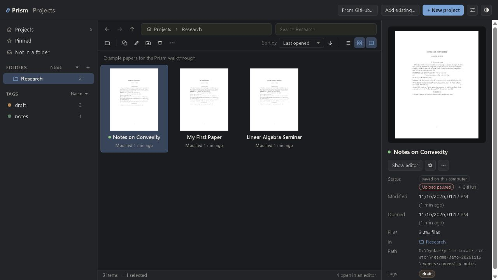
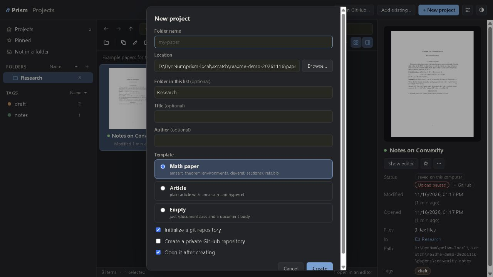
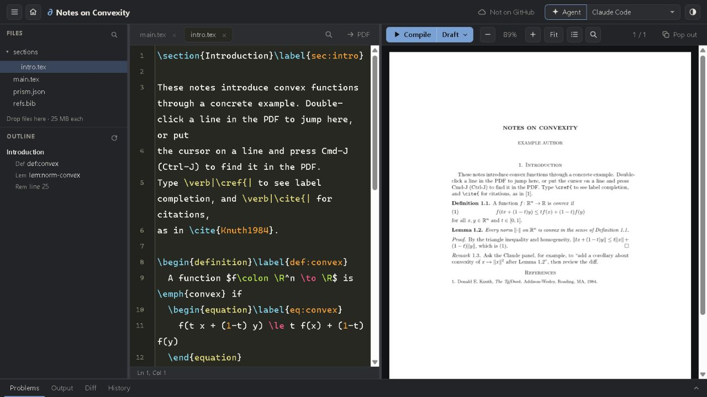
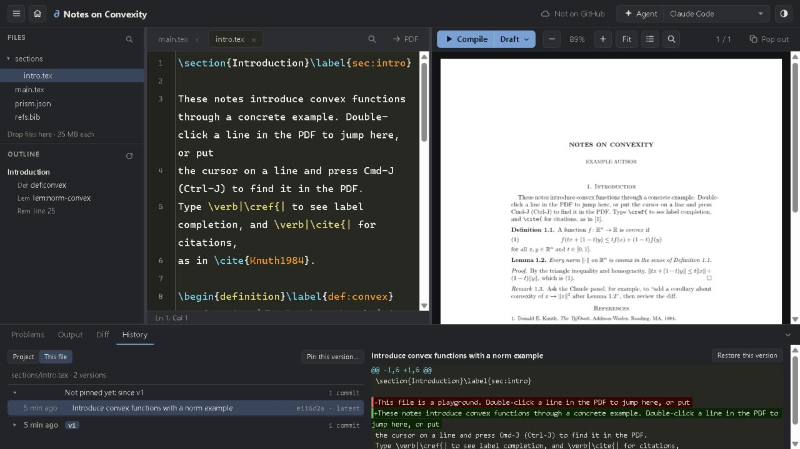
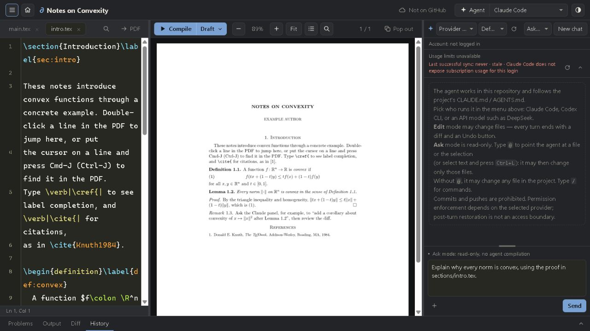

# Page walkthrough

[README](../../README.md) · [Installation](../installation.md) · [User guide](../user-guide.md)

These are screenshots of the running app, captured on Windows on 2026-11-16 with
example papers copied from [`examples/minimal`](../../examples/minimal). The
sample repositories are local only; no GitHub repository was created. The upload
status on Home reflects that no remote was configured. The AI question is an
unsent draft, not a recorded model response.

## 1. Home: organize your papers

Open Prism, then use **Add existing…** to register a paper folder. Compile it once
to give Home a PDF thumbnail. Choose **Large icons** to browse thumbnails, select
a paper to preview it, and double-click to open its editor. Folders and tags in
the sidebar let you group papers by topic or status.

The screenshot uses three sample papers in a folder named **Research**, with
**draft** and **notes** tags. See [Home reference](../user-guide.md#home-page).

## 2. New project: choose a template

1. Click **+ New project**.
2. Enter a folder name and select its location outside the Prism installation.
3. Choose **Article**, **Math paper** or **Empty**.
4. Keep **Initialize a git repository** for local history. **Create a private
   GitHub repository** is optional and needs GitHub setup first.
5. Click **Create** to open the editor.

## 3. Editor: source and PDF together

Copy the minimal example to your papers folder and add that copy on Home. Open
`sections/intro.tex`, then click **Compile**. The app builds the root `main.tex`
because `prism.json` selects it. The screenshot shows the compiled definition of
convexity and the corresponding source.

Double-click PDF text to jump to the source; use Ctrl+J / Cmd+J in the editor to
jump to the PDF. Click **Agent** to show or hide the assistant. Ctrl+B / Cmd+B
shows or hides the Files sidebar when you want more writing space.

## 4. History: inspect a change

With git installed, open **History → This file** and select a commit to inspect
its changes. **Pin this version…** names the current project state;
**Project** opens project-wide history. The demonstration has a `v1` pin and a
later commit changing the introduction. You can reproduce it by making an edit
and waiting for the automatic history save.

Restoring a file or project changes your working files. Use a copied example
when trying restoration. See [history and sync](../user-guide.md#history-and-sync-with-github).

## 5. Agent: prepare a question

Open **Agent**, pick a configured provider from the top menu, then select
**Ask (read-only)**. For example:

> Explain why every norm is convex, using the proof in sections/intro.tex.

The screenshot stops before **Send** and shows an account that is not logged in.
To receive a response, finish your provider's login or API configuration first.
**Edit** mode lets the agent change files; review the resulting diff and use
**Undo this turn** if needed. See [provider setup](../user-guide.md#choosing-the-ai-claude-code-codex-deepseek-and-other-apis).

## Refreshing these screenshots

Use a separate `PRISM_STATE_DIR` and copies of the example paper so your normal
project list is not included. Keep demonstration repositories without remotes,
disable app self-updates with `PRISM_AUTO_UPDATE=0`, and avoid including account
identifiers or keys. Compile the papers with Prism, arrange the views using the
app controls, and capture each page. Keep the five `.jpg` filenames used here
and in the main README, and check that the images still match their captions.
